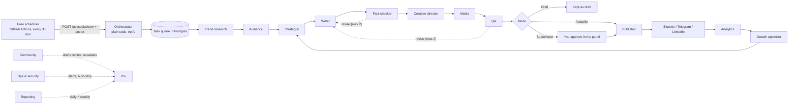

# Social Autopilot

A small team of AI agents that researches, writes, fact-checks, designs, quality-checks, posts and learns for the VocalisAi social accounts, at a cost of ₹0. Control panel: **Admin → Content → Social Autopilot** (`/admin/social`).

## 1. How it works

- **Persistent state:** tasks, posts, metrics and notes live in five Postgres tables (`SocialTask`, `SocialPost`, `SocialMetric`, `SocialNote`, `SocialSetting`). A restart loses nothing; a task whose worker died is re-queued after 5 minutes.
- **Plain code decides, AI judges:** scheduling, limits, permissions, duplicate detection, claim rules and the stop switch are deterministic code. The free Gemini model does research, writing, fact/English review, creative briefs and comment triage, behind a daily call cap (default 40).
- **Safety limits** (all in `src/lib/social/orchestrator.ts` and `agents/`): 3 attempts per task with back-off, 40 s per task, task chains cut at depth 10, at most 2 rewrites per post, at most 8 posts per platform per day, a post that missed its slot by over 12 h goes back for review.

## 2. Agents (registry: `src/lib/social/registry.ts`, shown in the panel's *Agents* tab)

| Agent | Does | AI? | Acts in public? |
|---|---|---|---|
| Orchestrator (`orchestrator.ts`) | Seeds the schedule, claims tasks (atomic), runs up to 3 in parallel, retries, recovers, blocks on stop | no | no |
| Trend Research | Reads public Google News feeds for the niche; stores opportunity + source link + date; marks verified vs unverified | yes | no |
| Audience Intelligence | Aggregated practice counts/averages and sign-up counts (no personal data) + comment topics → insights | yes | no |
| Content Strategist | Fills empty posting slots; gives each post its own hook type, story shape, cast, visual style, CTA, pillar, voice by rotation | yes | no |
| Content Writer | Writes inside that direction; for reels/shorts a multi-character dialogue script with scenes, sound effects and music | yes | no |
| Fact-Checking | Rules: any statistic/study/quote must trace to a researched source. AI: checks the English advice is correct and consistent | yes | no |
| Creative Director | Card headline, accessibility text, visual notes | yes | no |
| Media Production | Renders and validates the image card (real PNG, 1080×1080, <900 KB); validates video script | no | no |
| Content QA | Length/hashtag limits, hype and AI-cliché phrases, placeholders, broken links, missing alt text, **near-duplicate detection**; sends failures back | no | no |
| Publishing | Posts once (atomic status switch), retries only temporary errors, respects stop and mode | no | **yes** |
| Community Management | Classifies replies; drafts answers to questions/praise; escalates complaints and sensitive items. **Never posts a reply.** | yes | no |
| Analytics | Collects real Bluesky numbers; unknown stays *unknown* (never 0) | no | no |
| Growth Optimization | Compares hooks/shapes/styles/CTAs after ≥12 posts with numbers (≥3 per option); nudges choices by at most 0.7×–1.4× | no | no |
| Operations & Security | Missing/expiring credentials, 3 failed posts in a row → switches publishing off, stuck posts, failures, AI quota; redacts secrets | no | no |
| Reporting | Daily and weekly reports: results kept apart from suggestions | no | no |
| Memory (`memory.ts`) | Shared record: freshness, topics already covered, redaction. A service, not a task runner | no | no |

**Not built as separate agents (on purpose):** Competitor Intelligence and Social Listening (public feeds go through Trend Research; scraping competitors or mass-commenting is deliberately not done), Conversion/Funnel (tracked links count clicks), Reputation (covered by Community escalation).

## 3. Why posts will not repeat

1. **By construction:** each slot gets a direction from `directions.ts`: hook type (12), story shape (10), cast (6), visual style (8), CTA (7), pillar (6), voice (5). None of hook/story/style may repeat within the last 3 posts, and the least recently used option wins.
2. **By evidence:** the strategist must give each post a different topic backed by a research note when possible.
3. **By check:** QA rejects a post whose opening matches, whose hook is close to, or whose body overlaps 30%+ with an earlier post, or whose topic was already covered.
4. **By learning:** the optimizer favours what worked, but the rotation rule stops it repeating a winner back-to-back.

## 4. Modes and the stop switch

| Mode | Behaviour |
|---|---|
| Draft | Researches and writes. Never publishes (even if you approve). |
| Supervised | Posts wait in **Review**; you press Approve. |
| Autopilot | Posts that pass every check publish at their slot. Instagram, YouTube and X are never auto-posted (see §6). |
| Emergency stop | Red button. Publishing is refused immediately, including a post already being prepared. Research and drafting continue. **Resume** releases waiting posts. |

Autopilot never bypasses the daily AI cap, the 8-posts-a-day cap, platform permissions or QA.

## 5. Setup: numbered steps (Windows PowerShell)

Everything below is free. The panel's *Setup checklist* shows what is still missing.

1. **Apply the database change** (the owner approves first; take a Neon backup branch, see `DEPLOYMENT.md`). With `DATABASE_URL` pointing at the right branch: `npx.cmd prisma migrate deploy`. It only adds five tables. To reverse: the `DROP TABLE` line at the top of `prisma/migrations/20261019180000_social_autopilot/migration.sql`.
2. **Make the secret.** `node -e "console.log(require('crypto').randomBytes(32).toString('hex'))"` and keep the output.
3. **Add Vercel environment variables** (Vercel → Project → Settings → Environment Variables, Production): `CRON_SECRET` = the secret; `GEMINI_API_KEY` already exists.
4. **Bluesky** (free): create an account → Settings → Privacy and security → **App passwords** → add one. Set `BLUESKY_HANDLE` (e.g. `vocalisai.bsky.social`) and `BLUESKY_APP_PASSWORD` in Vercel.
5. **Telegram** (free): in Telegram open `@BotFather` → `/newbot` → copy the token. Create a channel, add the bot as an **administrator**. Set `TELEGRAM_BOT_TOKEN` and `TELEGRAM_CHANNEL_ID` (`@yourchannel`). For alerts to your phone: send any message to your bot, open `https://api.telegram.org/bot<TOKEN>/getUpdates`, copy `chat.id`, and set it as `TELEGRAM_OWNER_CHAT_ID`.
6. **Redeploy** on Vercel so the variables apply.
7. **Start the free scheduler.** Copy `docs/social-templates/social-autopilot.yml` to `.github/workflows/social-autopilot.yml` (create the folder; add it through the GitHub website if your push is refused for workflow files). In GitHub → Settings → Secrets and variables → Actions add `AUTOPILOT_SITE_URL` (`https://vocalisai.vercel.app`) and `AUTOPILOT_CRON_SECRET` (the secret from step 2). Then Actions → *Social Autopilot heartbeat* → **Run workflow** once to test.
8. Open **Admin → Social Autopilot**. Leave it on **Supervised** for the first two weeks and read what it prepares. Switch to Autopilot only when you trust the output.

**If the panel says the scheduler has not run:** GitHub pauses scheduled workflows on repositories with no activity for about 60 days and may delay runs. Open the Actions tab and click *Enable workflow*, or press **Run a cycle now** in the panel. Vercel Hobby cron can only run once a day, so it is a poor substitute; it does work as a backup: add `{"crons":[{"path":"/api/social/cron","schedule":"0 3 * * *"}]}` to `vercel.json` and Vercel will send `Authorization: Bearer $CRON_SECRET` itself.

## 6. What is free, and the limits

**Honesty note:** during the build only the Vercel Hobby cron limit (once a day) was confirmed from Vercel's own pricing page. Everything else below is from the platforms' documented behaviour as understood when this was written; terms and quotas change, so check each platform's current free-tier page before relying on it. Nothing here activates a paid service.

| Item | Cost | Limits / catches |
|---|---|---|
| GitHub Actions scheduler | ₹0 on a public repo | Delays of minutes; paused after ~60 days of no repo activity |
| Vercel | ₹0 on Hobby | Cron once a day; function time limit applies (each run stops at ~45 s and continues next run). Not verified for your plan: check Vercel → Settings → Functions |
| Gemini (existing key) | free tier | Daily quota set by Google; the panel caps calls at 40/day (change in Settings). Hitting the quota just delays work to the next day |
| Bluesky | ₹0 | Official API, app password. Image limit ~1 MB (cards are ~50 KB) |
| Telegram channel | ₹0 | The Bot API gives **no view counts**, so Telegram posts are not scored on numbers |
| LinkedIn | ₹0 | Adapter written but **not tested against a live account**; needs a LinkedIn developer app with `w_member_social`; tokens expire (~60 days); API version header may need updating (`LINKEDIN_API_VERSION`). Text posts only |
| Instagram, YouTube, X | ₹0 | **Not auto-posted.** Their free APIs need app review (Instagram), quotas (YouTube) or paid tiers/limits (X). The panel prepares the post and script; you post and press *I posted this* |
| Voice, music, video rendering | n/a | **Not live.** Reels/shorts get a full multi-character dialogue script (speakers, lines, scene visuals, sound effects, music brief) marked *script only*. Rendering needs a free text-to-speech + ffmpeg step in Actions that has not been built or tested; the existing ElevenLabs integration is a paid-credit service and is not used here |
| Followers, watch time, retention | n/a | Not available from these free APIs; check each app's insights. Likes, replies and reposts are collected for Bluesky |
| Sign-ups from social | n/a | Not attributed yet. Tracked links (`/go/<post>`) count clicks per post |

Nothing here promises growth. The weekly report says plainly when there is not enough data; do not read anything into a single post.

## 7. Day to day

- **Daily (2 minutes):** open *Review*, read, Approve or Reject. Check *Activity → Failures*. A Telegram message arrives only when something needs you.
- **Reports:** *Memory → Reports* (daily 9 pm India time; weekly Sunday).
- **Change times/platforms/posts per day:** *Settings* tab. Times are India time.
- **Something looks wrong:** press **Emergency stop**, then read *Activity*.

## 8. Developer notes

- Code: `src/lib/social/` (agents in `agents/`), routes `src/app/api/social/cron`, `src/app/api/admin/social`, `src/app/go/[id]`, panel `src/app/admin/social/page.tsx`.
- Tests (no network, no database except the store contract): `npx vitest run tests/unit/social-*.test.ts`. `social-store.test.ts` also needs the migration applied to the test database. Coverage: queue/claim concurrency, retry/back-off, stale recovery, stop, loop caps, modes, full research→publish→analytics→learning cycle, duplicates, fact rules, adapters, real image rendering.
- Add an agent: write handlers in `agents/`, add it to `registry.ts`, enqueue its task from a seed (`seedRecurring`) or from another agent's `next`. Add a platform: implement `Publisher` in `platforms.ts` and register it in `publishersFor`.
- Secrets are read only from environment variables, never stored in the database, and `redact()` strips token-like strings from stored text.
